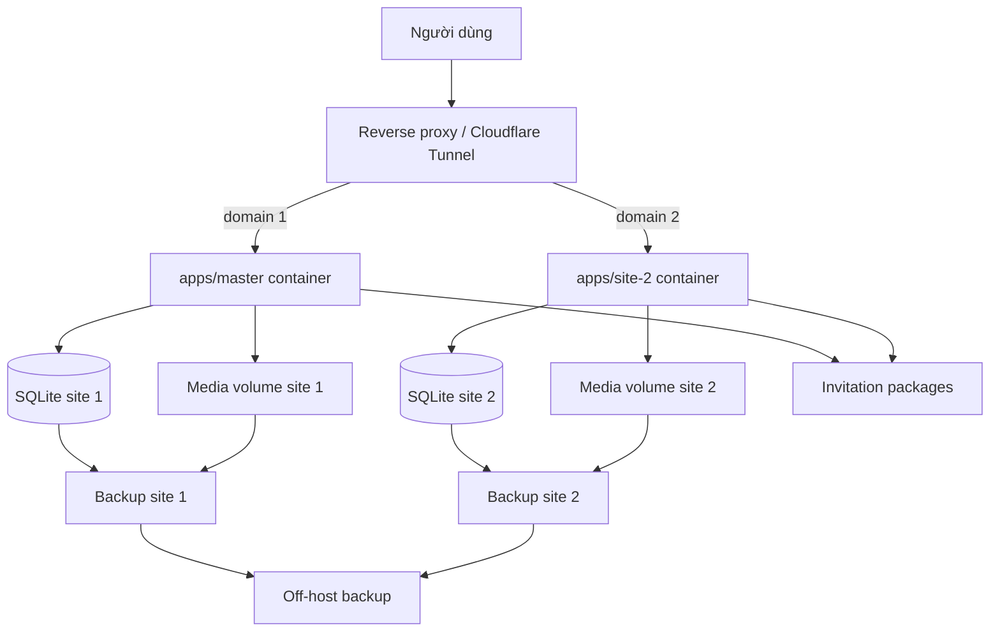

# Multi-Site Wedding Platform Implementation Plan

> **For agentic workers:** REQUIRED SUB-SKILL: Use superpowers:subagent-driven-development (recommended) or superpowers:executing-plans to implement this plan task-by-task. Steps use checkbox (`- [ ]`) syntax for tracking.

**Goal:** Chuyển Chungdoi từ một website thành nền tảng chung cho hai website thiệp cưới có UI, domain, dữ liệu và vận hành độc lập nhưng dùng chung engine và thư viện mẫu thiệp.

**Architecture:** Một monorepo chứa hai ứng dụng Next.js độc lập và các package nội bộ dùng chung. Mỗi app được build thành container riêng, dùng database SQLite, media volume, environment, secret, cron, backup và domain riêng; reverse proxy hoặc Cloudflare Tunnel định tuyến theo hostname trên cùng VPS.

**Tech Stack:** Next.js 16 App Router, React 19, TypeScript strict, Tailwind CSS v4, shadcn/Radix, next-intl (chỉ tiếng Việt), Prisma 7, better-sqlite3, Docker Compose, reverse proxy hoặc Cloudflare Tunnel, systemd timers.

**Spec:** Tài liệu này đồng thời là bản ghi quyết định kiến trúc và kế hoạch triển khai đã thống nhất ngày 2026-09-12.

## Global Constraints

- Không dùng hai Git branch sống lâu để đại diện cho hai site; dùng một nhánh chính và branch ngắn hạn theo feature.
- Không để hai app cùng ghi một SQLite database hoặc dùng chung media volume.
- UI marketing và sản phẩm của hai site được phép khác gần như hoàn toàn; chỉ chia sẻ những phần thực sự có cùng hành vi.
- Mẫu thiệp có một nguồn code chung; khác biệt nhỏ theo site được biểu diễn bằng typed variant/theme override.
- Thứ tự ưu tiên cấu hình thiệp: invitation override → site/template variant → shared template default.
- Mọi copy hiển thị cho người dùng tiếp tục đi qua `messages/vi.json`, không hardcode chuỗi.
- Không sửa `src/generated/prisma/**`; Prisma client luôn được sinh lại bằng script hiện có.
- Build local dùng `npm run build:local`; gate cuối dùng `npm run check`.
- Không deploy hoặc thay đổi production trong các task kiến trúc nếu chưa có phê duyệt riêng.

---

## 1. Tóm tắt quyết định

Website hiện tại chạy tại `thiepmungonline.com`. Sản phẩm thứ hai sẽ dùng domain khác hoàn toàn, có UI chủ yếu khác—bao gồm homepage, pricing, marketing và có thể dashboard—nhưng dùng chung hệ thống mẫu thiệp.

Phương án được chọn là:

```text
Một Git repository, một main branch
├── apps/master       → domain 1 → container 1 → database/media 1
├── apps/site-2       → domain 2 → container 2 → database/media 2
└── packages/
    ├── invitation-core
    ├── invitation-data
    └── shared-ui (chỉ khi thực sự dùng chung)
```

Phương án một Next.js app với nhiều điều kiện `SITE_ID` không còn là kiến trúc đích vì phần lớn UI sẽ khác. `SITE_ID` vẫn hữu ích trong build/runtime config, analytics và các override nhỏ. Hai repository hoặc hai branch dài hạn cũng không được chọn vì sẽ tạo code drift và bắt buộc đồng bộ bug fix bằng merge/cherry-pick.

## 2. Mục tiêu và phạm vi ngoài

### Mục tiêu

- Hai website phát triển UI và release độc lập.
- Feature dùng chung được sửa một lần; feature riêng nằm đúng app sở hữu nó.
- Template có thể chỉ khả dụng trên một site.
- Template chung có thể khác font, màu, spacing, animation hoặc asset theo site.
- Hai deployment trên cùng VPS không đọc/ghi nhầm dữ liệu của nhau.
- Có kiểm thử, backup, healthcheck và rollback riêng cho từng site.

### Không nằm trong phạm vi ban đầu

- SSO hoặc đồng bộ tài khoản thời gian thực giữa hai domain.
- Đồng bộ database sau thời điểm clone ban đầu.
- Kubernetes hoặc microfrontend.
- Một control plane động để tạo thêm hàng trăm tenant/domain.
- Tách repository hoặc duy trì hai nhánh release dài hạn.

## 3. Kiến trúc đích



### Ranh giới sở hữu

| Phần | Site 1 | Site 2 | Dùng chung |
|---|---:|---:|---:|
| Homepage, pricing, marketing | Có | Có | Không mặc định |
| Dashboard/product UI | Có | Có | Chỉ chia sẻ logic ổn định |
| Template renderer và sections | Import | Import | Có |
| Template availability | Cấu hình riêng | Cấu hình riêng | Registry chung |
| Template variant/assets | Override riêng | Override riêng | Default chung |
| Database, uploads, session | Riêng | Riêng | Schema/migration có thể chung |
| Payment, email, cron | Riêng | Riêng | Library có thể chung |

## 4. Cấu trúc repository đề xuất

```text
apps/
  master/
    src/app/
    messages/vi.json
    next.config.ts
    package.json
  site-2/
    src/app/
    messages/vi.json
    next.config.ts
    package.json
packages/
  invitation-core/
    src/components/
    src/templates/
    src/theme/
  invitation-data/
    src/contracts/
    prisma/
  shared-ui/
    src/
scripts/
  deploy-site.sh
  verify-site.mjs
deploy/
  master/
  site-2/
package.json
```

Không cần di chuyển toàn bộ code một lần. App hiện tại trở thành `apps/master`; sau đó mới trích xuất boundary thiệp và tạo app thứ hai. Chỉ đưa code vào `shared-ui` sau khi cả hai app thực sự có cùng contract và hành vi.

## 5. Feature và template variants

Feature ownership cần thể hiện bằng cấu trúc import và typed config, không chỉ ẩn nút trên UI:

```ts
type SiteId = "master" | "site-2";

type FeatureFlags = {
  featureA: boolean;
  featureB: boolean;
  featureC: boolean;
};

const featuresBySite: Record<SiteId, FeatureFlags> = {
  master: { featureA: true, featureB: true, featureC: false },
  "site-2": { featureA: true, featureB: false, featureC: true },
};
```

API, server action, permission, cron và payment path phải kiểm tra cùng policy; không coi việc ẩn UI là authorization.

Template contract dự kiến:

```ts
type TemplateVariant = {
  typography?: { coupleNameSizePx?: number };
  assets?: Record<string, string>;
  colors?: Record<string, string>;
  spacing?: Record<string, string>;
};

type TemplateDistribution = {
  availableOn: readonly SiteId[];
  variants?: Partial<Record<SiteId, TemplateVariant>>;
};
```

Một template chỉ fork thành implementation riêng khi section order, opening interaction, editor fields hoặc behavior khác đáng kể. Font size và asset chỉ là variant.

## 6. Topology VPS và domain

```text
/srv/thiepmungonline/
  compose.yaml
  .env.runtime
  data/prod.db
  data/uploads/
  backups/

/srv/<site-2>/
  compose.yaml
  .env.runtime
  data/prod.db
  data/uploads/
  backups/
```

Hai container nghe hai port loopback khác nhau. Reverse proxy/Tunnel là thành phần duy nhất public, giữ nguyên `Host` và route domain 1/site 1, domain 2/site 2. Cache key phải gồm hostname.

Đặt CPU/RAM limit và reservation để giảm noisy-neighbor, nhưng ghi nhận rằng cùng VPS vẫn là một failure domain. Build Next/Docker có thể làm site đang chạy chậm; ưu tiên build artifact ngoài VPS hoặc kiểm tra dung lượng/RAM trước build. Repo hiện yêu cầu ít nhất 6 GiB disk trống cho cold build và không được bỏ gate này.

## 7. Ma trận cấu hình

| Nhóm | Site 1 | Site 2 | Quy tắc |
|---|---|---|---|
| `SITE_ID` | `master` | `site-2` | Không suy luận từ dữ liệu |
| `NEXT_PUBLIC_SITE_URL` | Domain 1 | Domain 2 | Được đóng vào build |
| `DATABASE_URL` | Volume DB 1 | Volume DB 2 | Tuyệt đối không trùng physical path |
| `SESSION_SECRET` | Secret 1 | Secret 2 | Cookie/session độc lập |
| OAuth | Callback domain 1 | Callback domain 2 | Đăng ký cả hai callback hoặc client riêng |
| PayOS | Config 1 | Config 2 | Webhook và reconcile không xử lý chéo |
| Resend/email | Brand/domain 1 | Brand/domain 2 | Sender/link/reminder riêng |
| Maps | Referrer domain 1 | Referrer domain 2 | Cập nhật restriction |
| Analytics | Property 1 | Property 2 | Không trộn báo cáo nếu business yêu cầu tách |
| Cron | Timer 1 | Timer 2 | DB/env/lock riêng |

Không commit secret hoặc sao chép nguyên environment production sang site 2. `NEXT_PUBLIC_SITE_URL` ảnh hưởng canonical, sitemap, robots, Open Graph và absolute URL nên phải build mỗi app với domain thật của nó.

## 8. Clone và tách dữ liệu

Clone chỉ diễn ra một lần tại mốc cutover:

1. Chọn cửa sổ snapshot và ghi nhận thời điểm.
2. Tạo SQLite backup nhất quán bằng API backup/transaction đã kiểm chứng; không `cp` file đang ghi.
3. Copy media bằng manifest/checksum.
4. Restore vào physical path riêng của site 2.
5. Chạy `PRAGMA quick_check` và migration preflight.
6. Vô hiệu hóa email reminder, payment reconcile và webhook của site 2 trong staging.
7. Quyết định rõ dữ liệu user, admin, invitation, payment, slideshow và reminder nào được giữ.
8. Sau cutover, cấm mọi job đồng bộ ngược giữa hai DB trừ khi có thiết kế mới được duyệt.

Rủi ro lớn nhất của clone toàn DB là email cũ được gửi lại, payment pending được reconcile từ hai site, URL published mang domain cũ, và hai site phát sinh cùng namespace order code. Cần scrub hoặc đóng băng các workflow này trước khi bật site 2.

## 9. Git và release workflow

- `main` là nguồn sự thật duy nhất.
- Branch ngắn hạn: `codex/shared-...`, `codex/master-...`, `codex/site-2-...`.
- Thay đổi `packages/invitation-*` kích hoạt test/build cả hai app.
- Thay đổi chỉ trong `apps/master` kích hoạt site 1.
- Thay đổi chỉ trong `apps/site-2` kích hoạt site 2.
- Mỗi deployment ghi lại commit SHA, site ID, build-time site URL và database migration state.
- Không deploy đồng thời hai site trong giai đoạn đầu; deploy tuần tự để giữ rollback và tài nguyên VPS.

## 10. Failure modes và biện pháp

| Failure mode | Hậu quả | Biện pháp |
|---|---|---|
| Deploy nhầm target | Restart/ghi nhầm site | Fail-closed target manifest, kiểm tra domain/path/container trước mutation |
| Hai app dùng chung DB/media | Rò rỉ và hỏng dữ liệu | Physical volume riêng, startup assertion |
| Cron chạy trùng | Email/payment xử lý hai lần | Timer riêng, site-scoped lock/idempotency |
| Cache không phân biệt host | UI/SEO chéo domain | Host-aware key, purge/test từng domain |
| Build thiếu RAM/disk | Cả hai site chậm hoặc down | Build off-host, resource gate, deploy tuần tự |
| Clone payment/reminder cũ | Thu tiền/gửi email sai | Disable jobs, scrub/approve data set trước activation |
| OAuth/webhook sai callback | Login/payment lỗi | Provider checklist và smoke test domain thật |
| VPS hỏng | Cả hai site down | Off-host backup, restore drill, tài liệu chuyển VPS |
| Migration lỗi site 2 | Site 2 down | Backup, migrate candidate copy, rollback DB+image độc lập |

## 11. Kế hoạch triển khai theo giai đoạn

### Task 1: Inventory và decision record

**Files:**
- Modify: tài liệu này
- Inspect: `src/app/`, `src/components/`, `src/data/`, `src/lib/site-url.ts`, `src/lib/prisma.ts`, `src/lib/session.ts`
- Inspect: `scripts/deploy-vps.sh`, `scripts/deploy-fast.sh`, `scripts/vps/compose.yaml`, `docs/deploy-vps.md`

- [ ] Lập bản đồ route/component theo ba nhóm: master-only, site-2-only, shared invitation.
- [ ] Liệt kê mọi nơi đọc domain, database, upload root, cookie, OAuth, PayOS, email, Maps, analytics và cron.
- [ ] Chốt các decision gate ở mục 13 và cập nhật tài liệu bằng giá trị được duyệt.
- [ ] Review inventory để bảo đảm không đọc generated/raw-crawl directories bị cấm trong `AGENTS.md`.

### Task 2: Thiết lập workspace và hai app

**Files:**
- Create: `apps/master/package.json`, `apps/site-2/package.json`
- Create: `packages/invitation-core/package.json`, `packages/invitation-data/package.json`
- Modify: root `package.json`, lockfile, TypeScript/Tailwind configuration liên quan
- Test: workspace build/typecheck commands

- [ ] Viết test/config check thất bại khi một workspace app không khai báo site ID và site URL hợp lệ.
- [ ] Thiết lập workspace tối thiểu, giữ app hiện tại hoạt động như master trước khi tạo UI site 2.
- [ ] Chạy lint/typecheck/build master và xác nhận route production hiện tại không đổi.
- [ ] Tạo skeleton site 2 với health route và homepage tối thiểu qua catalog tiếng Việt.
- [ ] Chạy hai app đồng thời trên port local khác nhau.

### Task 3: Trích xuất invitation core

**Files:**
- Move/refactor: template registry, renderer, shared invitation sections và theme contracts từ `src/components/` và `src/data/` sang `packages/invitation-core/src/`
- Create: package-level tests cho registry/distribution/variant resolution
- Modify: hai app để import public API của package

- [ ] Viết characterization tests cho một tập template đại diện trước khi move.
- [ ] Định nghĩa public exports nhỏ và typed contracts; không để app import deep internal paths.
- [ ] Di chuyển theo từng nhóm nhỏ, chạy lint/typecheck/unit test sau mỗi nhóm.
- [ ] Thêm test precedence: invitation override → site variant → shared default.
- [ ] Thêm test template unavailable trả 404/policy đã chọn, đồng thời bảo vệ invitation đã publish theo quyết định migration.
- [ ] So sánh trực quan desktop/mobile cho template đại diện; không dùng lint làm bằng chứng fidelity.

### Task 4: Site-specific UI và feature ownership

**Files:**
- Modify: `apps/master/src/app/**`
- Create/modify: `apps/site-2/src/app/**`
- Create: typed site config/feature policy trong mỗi app hoặc package config nhỏ

- [ ] Giữ homepage/pricing/dashboard trong app sở hữu chúng.
- [ ] Chỉ trích component sang `shared-ui` khi API và behavior giống nhau.
- [ ] Thêm server-side authorization test cho feature chỉ thuộc một site.
- [ ] Thêm route test chứng minh Feature A có ở cả hai, B chỉ site 1, C chỉ site 2.
- [ ] Kiểm tra toàn bộ user-facing copy qua catalog `vi` tương ứng.

### Task 5: Parameterize build và deployment

**Files:**
- Modify: `scripts/deploy-vps.sh`, `scripts/deploy-fast.sh`, `scripts/check-deploy-inputs.mjs`
- Create: `deploy/master/`, `deploy/site-2/` manifests/compose templates
- Modify/create: deploy tests hiện có

- [ ] Viết test fail-closed cho unknown site, domain/path mismatch, duplicate port và duplicate data path.
- [ ] Thay hardcode production bằng allowlist manifest có `siteId`, domain, app dir, image, container, port và scheduler prefix.
- [ ] Build artifact riêng với đúng `NEXT_PUBLIC_SITE_URL`.
- [ ] Giữ DB mount read-only trong candidate smoke test và rollback độc lập.
- [ ] Deploy thử vào environment không-production và xác minh deploy một site không restart site còn lại.

### Task 6: Provision VPS isolation

**Files:**
- Create/modify: VPS compose, reverse proxy/Tunnel ingress, systemd units và backup config
- Document: `docs/deploy-vps.md`

- [ ] Tạo app directory, Unix permissions, Docker network, data/media/cache volumes riêng.
- [ ] Đặt resource limits và healthcheck cho từng container.
- [ ] Route staging hostname của site 2 tới loopback port riêng; giữ `Host` header.
- [ ] Tạo timer names riêng và xác minh mọi command đọc đúng env/database.
- [ ] Thiết lập off-host backup và thực hiện một restore drill trên bản copy.

### Task 7: Clone dữ liệu an toàn

**Files:**
- Create: script snapshot/restore/scrub có dry-run và checksum
- Test: fixture SQLite và media manifest

- [ ] Viết test chứng minh snapshot nhất quán khi source DB đang có WAL.
- [ ] Tạo snapshot production theo cửa sổ được duyệt; không expose secret/log dữ liệu nhạy cảm.
- [ ] Restore DB/media site 2 và chạy quick check, migration preflight, checksum media.
- [ ] Áp dụng chính sách scrub cho payment/reminder/domain URL được duyệt.
- [ ] Giữ cron/webhook/email site 2 tắt cho đến khi smoke test hoàn tất.

### Task 8: Integrations và end-to-end verification

**Files:**
- Modify: OAuth/provider config, payment/email/Maps/analytics config theo site
- Test: targeted Playwright specs và provider smoke scripts

- [ ] Kiểm tra signup/login/logout và cookie isolation trên hai domain.
- [ ] Kiểm tra editor, publish, invitation URL, upload, guestbook và media retrieval.
- [ ] Kiểm tra template availability và variant assets/font trên desktop/mobile.
- [ ] Kiểm tra payment create/callback/webhook/reconcile bằng sandbox hoặc giao dịch được kiểm soát.
- [ ] Kiểm tra sender, link domain và reminder email; không gửi lại dữ liệu clone ngoài ý muốn.
- [ ] Kiểm tra canonical, sitemap, robots, Open Graph, www redirect, HTTPS và cache separation.
- [ ] Chạy `npm run lint`, `npm run typecheck`, test unit/targeted E2E, rồi `npm run check` làm gate cuối.

### Task 9: Cutover và rollback

**Files:**
- Modify: runbook trong `docs/deploy-vps.md`
- Create: release checklist/receipt cho site 2

- [ ] Ghi lại image, commit, DB checksum, media manifest và DNS state trước cutover.
- [ ] Hạ DNS TTL trước thời điểm chuyển nếu provider yêu cầu.
- [ ] Kích hoạt domain/TLS, sau đó integrations và cron theo thứ tự được duyệt.
- [ ] Theo dõi error rate, CPU, RAM, disk, SQLite busy errors, payment và email.
- [ ] Rollback độc lập bằng image trước và DB snapshot nếu acceptance gate thất bại.
- [ ] Xác minh site 1 không thay đổi trong và sau cutover site 2.

## 12. Acceptance criteria

- Hai domain trả đúng UI/app và không cache chéo.
- Hai container, DB, media, secrets, cron, backup và rollback độc lập.
- Restart/deploy site 2 không restart site 1.
- Shared template change có test/build cho cả hai app; app-specific change không bắt buộc deploy app kia.
- Template distribution và variant resolution có typed tests.
- Site 1 không gọi được API/feature chỉ dành cho site 2 và ngược lại.
- Auth, editor, publish, upload, guestbook, payment, email và SEO vượt qua smoke test trên từng domain.
- Database clone không kích hoạt payment reconciliation hoặc reminder email cũ ngoài ý muốn.
- Có backup ngoài VPS và restore drill thành công.
- Có rollback runbook và release receipt cho từng site.

## 13. Quyết định còn cần người dùng chốt

1. Tên sản phẩm và domain chính xác của site 2.
2. Những route/UI nào giữ chung, route/UI nào thiết kế lại hoàn toàn.
3. User/admin/invitation/payment/slideshow/reminder nào được clone sang site 2.
4. Tài khoản hai site độc lập hoàn toàn hay cần SSO trong tương lai.
5. PayOS, Resend, Google OAuth, Maps và analytics dùng account chung hay credential/property riêng.
6. Danh sách template/feature chỉ thuộc từng site và policy khi truy cập template không khả dụng.
7. CPU/RAM/disk allocation cho hai container và ngưỡng cần tách VPS.
8. Reverse proxy hiện có sẽ là Cloudflare Tunnel, Nginx hay Caddy.

## 14. Trình tự khuyến nghị

Không triển khai toàn bộ như một thay đổi lớn. Chia thành bốn milestone có thể review độc lập:

1. **Foundation:** inventory, workspace, giữ master không đổi.
2. **Shared invitation boundary:** trích core và chứng minh fidelity.
3. **Second product:** UI site 2, feature/template variants, runtime cô lập.
4. **Production launch:** clone dữ liệu, integrations, domain, verification và rollback.

Mỗi milestone phải có test và rollback riêng trước khi chuyển sang milestone kế tiếp.
